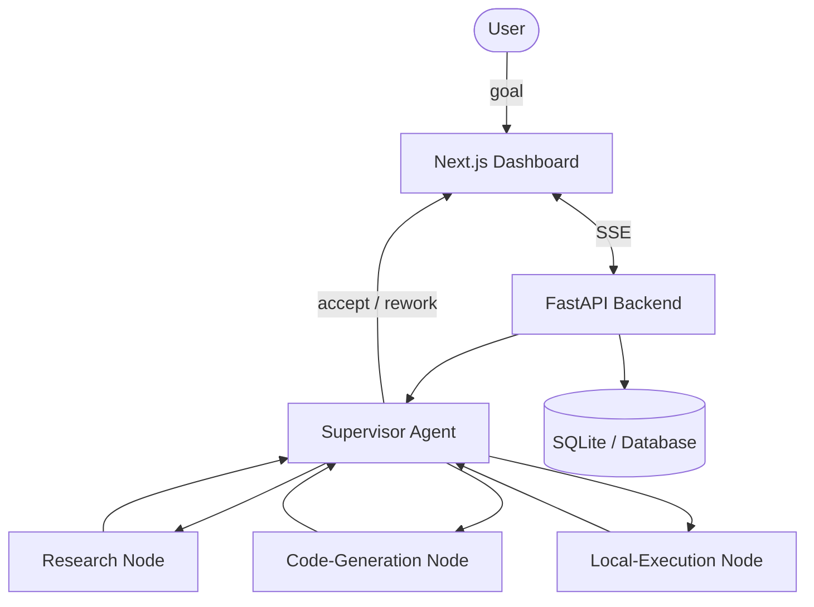

# Automated AI Labor

> **Transform AI from a "Tool" into a "Workforce" — pay for results, not process.**
> 把 AI 从「工具」升级为「员工」——只为结果付费，不为过程付费。

[](LICENSE)


**Automated AI Labor (AAL)** is an open-source platform exploring a **Result-as-a-Service (RaaS)** model: instead of renting a chat tool, a user describes a goal and autonomous multi-agent workflows deliver a finished outcome — and the user pays only when the result meets the bar.

## Highlights

- **Multi-agent orchestration** — a *Supervisor* agent plans and reviews while *Executor* agents (research, code generation, local execution) do the work, built on LangGraph.
- **Result-first workflow** — structured `TaskSpec` → execution → quality review → acceptance or rework loop.
- **Streaming dashboard** — a Next.js UI with Server-Sent Events (SSE) live progress, token-usage tracking, retry/cancel, and analytics.
- **Full-stack** — TypeScript / Next.js frontend + Python / FastAPI backend.

## Architecture



## Tech Stack

| Layer | Technology |
|-------|-----------|
| Frontend | Next.js 16 (React 19), TailwindCSS, TypeScript |
| Backend | Python, FastAPI, Uvicorn |
| AI Orchestration | LangChain, LangGraph (stateful, cyclic agent workflows) |
| Streaming | SSE (`sse-starlette`) |
| Auth | JWT (`python-jose`), bcrypt (`passlib`) |
| Search | DuckDuckGo Search (`langchain-community`) |

## Project Structure

```text
AutomatedAILabor/
├── frontend/              # Next.js (React + TailwindCSS)
│   ├── app/               # dashboard, login, start pages
│   ├── components/        # UI components
│   └── lib/               # API client, SSE streaming
├── backend/               # FastAPI
│   ├── agent/             # LangGraph nodes & workflow
│   ├── main.py            # API entrypoint
│   ├── auth.py            # JWT auth
│   ├── models.py          # SQLAlchemy models
│   └── requirements.txt
├── docs/                  # product, technical, design docs
└── docker-compose.yml
```

## Quick Start

### Backend

```bash
cd backend
python -m venv venv && source venv/bin/activate
pip install -r requirements.txt
cp .env.example .env       # fill in your API keys
uvicorn main:app --host 0.0.0.0 --port 8000 --reload
```

### Frontend

```bash
cd frontend
npm install
NEXT_PUBLIC_API_URL=http://localhost:8000 npm run dev
```

## Roadmap

- [x] Multi-agent supervisor/executor architecture
- [x] v1.1 web interface with streaming dashboard & token analytics
- [ ] More agent workers & deeper model-interaction optimization
- [ ] Automated Coder — "fix this GitHub issue" → Pull Request
- [ ] Content Marketer — draft a week of posts from a single brief

## Screenshots

Run the project locally and drop captured UI images into `docs/screenshots/`, then reference them here.

## License

[MIT](LICENSE) © AIGoBig
